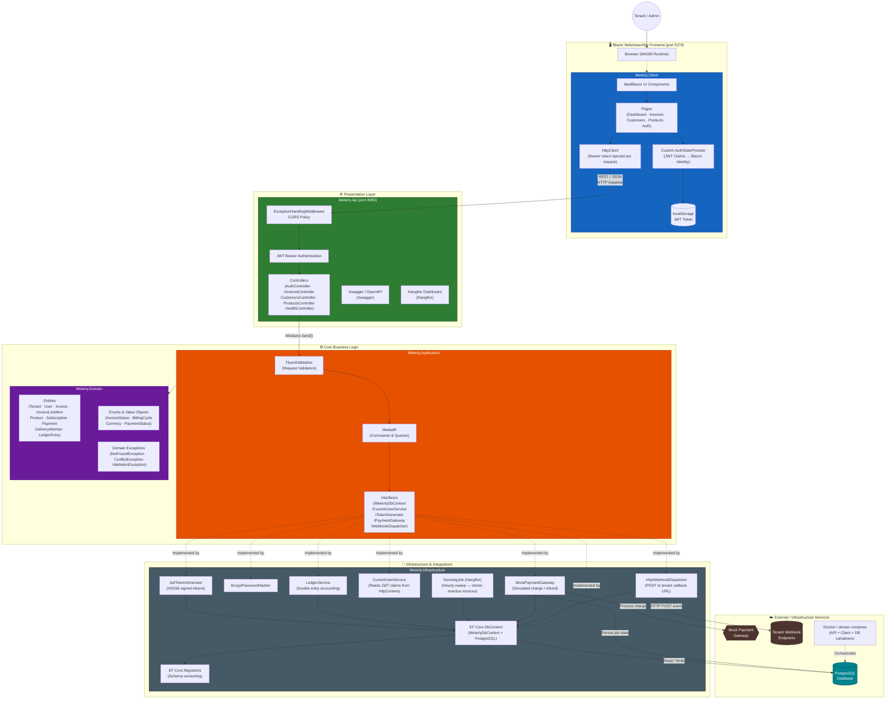

# Meterly — System Architecture

This document describes the complete architecture of the Meterly SaaS billing platform.

## Technology Overview

| Layer | Technology |
|---|---|
| **Frontend** | Blazor WebAssembly (C#), MudBlazor UI |
| **Backend API** | ASP.NET Core 8, Clean Architecture |
| **Database** | PostgreSQL (via Entity Framework Core) |
| **Auth** | JWT Bearer tokens |
| **Background Jobs** | Hangfire |
| **Containerisation** | Docker + docker-compose |

---

## Architecture Diagram

---

## Layer Responsibilities

### `Meterly.Client` — Blazor WebAssembly (PWA)
- Single-page application compiled to WebAssembly and served as static files
- Uses **MudBlazor** component library for the UI
- Custom `AuthStateProvider` decodes the JWT and exposes user identity to Blazor's auth system
- All API calls attach the JWT as a `Bearer` token; no server-side sessions
- Configured as a **Progressive Web App (PWA)** — installable on Windows/Mac/mobile

### `Meterly.Api` — ASP.NET Core 8
- Thin HTTP layer: validates JWT, maps routes, dispatches MediatR commands/queries
- Global exception handler returns consistent `ProblemDetails` JSON
- CORS is explicitly configured per allowed origin
- Swagger UI enabled for all environments

### `Meterly.Application` — Use Cases (CQRS)
- Each feature is a `Command` (mutates state) or `Query` (reads state), handled by a `Handler`
- FluentValidation pipelines run before every handler
- All external dependencies are hidden behind interfaces (ports)

### `Meterly.Domain` — Business Rules
- Pure C# with zero infrastructure dependencies
- Entity classes enforce invariants (e.g., you cannot pay an already-paid invoice)

### `Meterly.Infrastructure` — Adapters
- Implements all interfaces defined in Application
- EF Core with the Npgsql PostgreSQL provider
- Hangfire uses the same PostgreSQL database for its job queue
