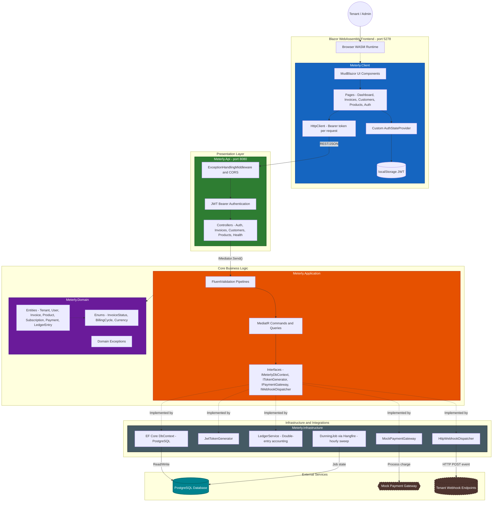

# Meterly - Multi-Tenant SaaS Billing and Subscription Platform

> A production-grade, multi-tenant SaaS billing platform built with ASP.NET Core, Blazor WebAssembly, Entity Framework Core, and PostgreSQL. Inspired by Stripe Billing and Chargebee.

## Tech Stack

| Technology | Purpose |
|---|---|
| **C# / .NET 8** | Language and runtime |
| **ASP.NET Core 8** | Web API backend |
| **Blazor WebAssembly** | SPA frontend (compiled C# to WASM) |
| **MudBlazor** | UI component library |
| **Entity Framework Core** | ORM with PostgreSQL |
| **PostgreSQL** | Primary database |
| **MediatR** | CQRS command/query handling |
| **FluentValidation** | Input validation pipelines |
| **JWT Bearer** | Authentication and multi-tenancy |
| **Hangfire** | Persistent background jobs (dunning) |
| **Docker** | Containerised development |
| **xUnit** | Unit and integration testing |
| **Swagger / OpenAPI** | API documentation |
| **PWA** | Installable as a Windows/Mac desktop app |

---

## Architecture

> See [ARCHITECTURE.md](./ARCHITECTURE.md) for full diagram with detailed layer descriptions.

---

## Project Structure

`
src/
├── Meterly.Domain           → Entities, enums, domain exceptions (zero dependencies)
├── Meterly.Application      → MediatR commands/queries, validators, interfaces
├── Meterly.Infrastructure   → EF Core, PostgreSQL, JWT, Hangfire, adapters
├── Meterly.Api              → Controllers, middleware, Swagger, CORS
└── Meterly.Client           → Blazor WebAssembly SPA (MudBlazor UI + PWA)

tests/
├── Meterly.UnitTests        → Pure business logic tests
└── Meterly.IntegrationTests → Full HTTP pipeline tests (in-memory DB)
`

---

## Quick Start

### Prerequisites
- [.NET 8 SDK](https://dotnet.microsoft.com/download)
- [Docker Desktop](https://www.docker.com/products/docker-desktop)

### 1. Start the Database

`ash
docker-compose up -d
`

Starts PostgreSQL on localhost:5432 with database meterly_db, user meterly_user, password meterly_password.

### 2. Run the Backend API

`ash
dotnet run --project src/Meterly.Api --urls "http://localhost:8080"
`

- API: http://localhost:8080
- Swagger UI: http://localhost:8080/swagger
- Hangfire Dashboard: http://localhost:8080/hangfire

### 3. Run the Frontend

`ash
dotnet run --project src/Meterly.Client
`

- App: http://localhost:5278

### 4. Run in Visual Studio

1. Open Meterly.sln
2. Right-click the Solution → Configure Startup Projects → Multiple startup projects
3. Set Meterly.Api to Start and Meterly.Client to Start
4. Press Ctrl+F5

### 5. Run Tests

`ash
dotnet test
`

---

## Core Billing Flow

`
Tenant registers → Creates Customers → Sets up Products/Plans
→ Creates Subscriptions → Generates Invoices → Processes Payments
→ Ledger entries written → Webhooks dispatched → Dunning on failure
`

---

## Development Phases

- [x] **Phase 1:** Project setup + Clean Architecture
- [x] **Phase 2:** PostgreSQL + EF Core + migrations
- [x] **Phase 3:** Authentication + multi-tenancy (JWT)
- [x] **Phase 4:** Customers
- [x] **Phase 5:** Plans + subscriptions
- [x] **Phase 6:** Usage metering
- [x] **Phase 7:** Invoice generation
- [x] **Phase 8:** Mock payments
- [x] **Phase 9:** Idempotency + webhooks
- [x] **Phase 10:** Double-entry ledger
- [x] **Phase 11:** Refunds + credits
- [x] **Phase 12:** Dunning + Hangfire
- [x] **Phase 13:** Testing (unit + integration)
- [x] **Phase 14:** Docker
- [x] **Phase 15:** Blazor WebAssembly frontend (PWA) + Documentation

---

## License

Educational project — built for learning.
