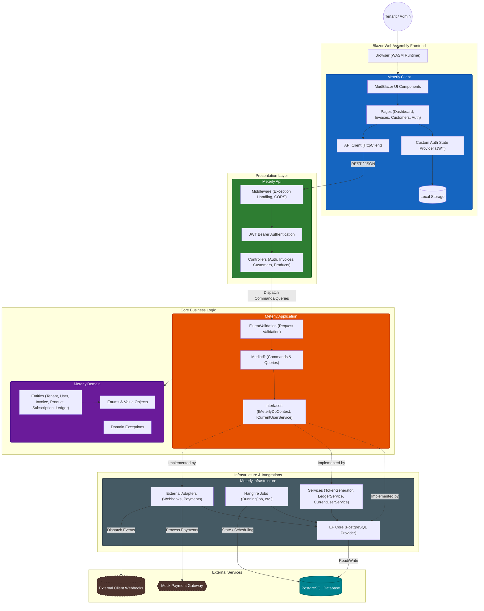

# Meterly Architecture Diagram

Here is the complete architectural diagram for the Meterly SaaS platform. 

> [!TIP]
> **How to use this with Excalidraw:**
> 1. Copy the code block below (everything between the ` ```mermaid ` and ` ``` ` tags).
> 2. Open [Excalidraw](https://excalidraw.com/).
> 3. Click the **More Tools** menu (the icon with a `+` or grid) or press `Shift + 1`.
> 4. Select **Mermaid to Excalidraw**.
> 5. Paste the code into the text area and click **Insert**.


