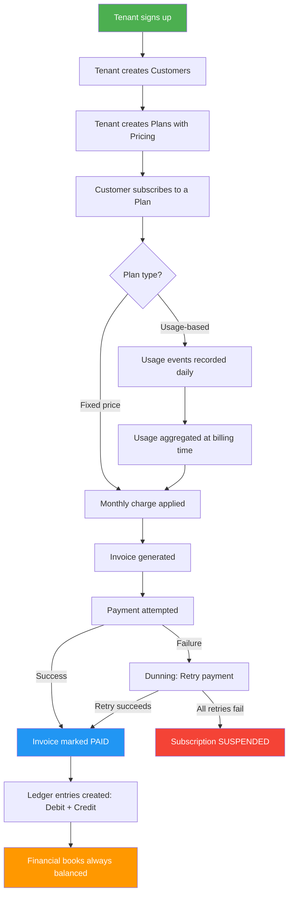
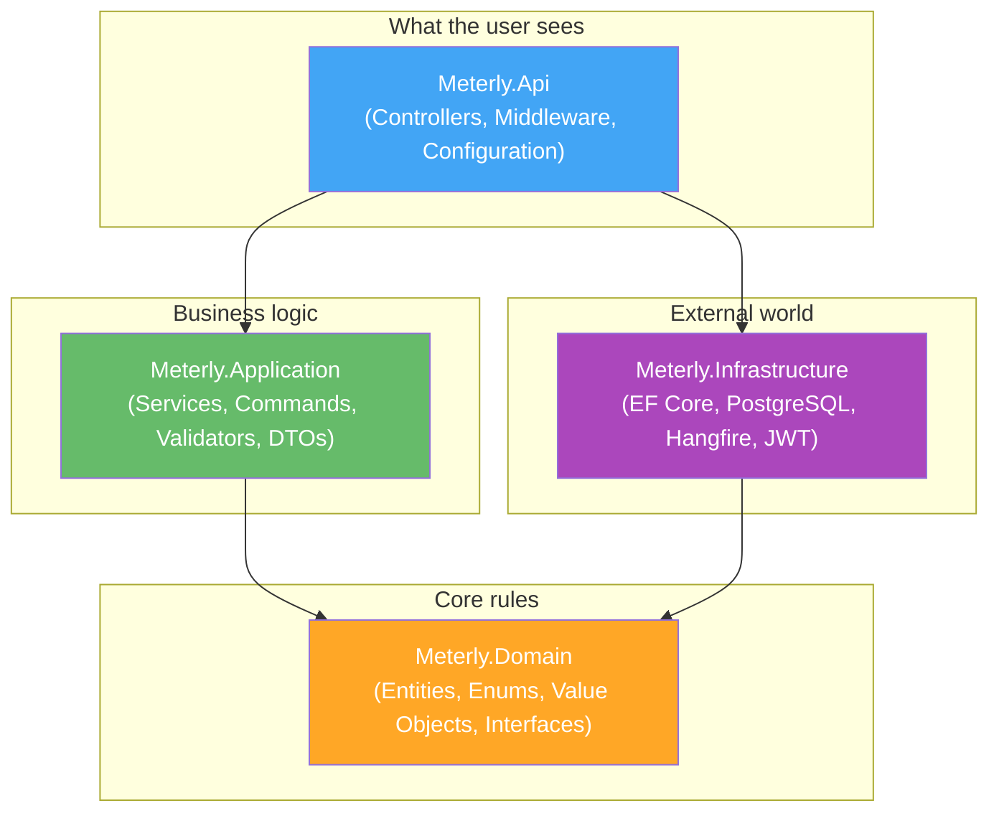

# Meterly — Phase 1: Project Setup & Architecture

## What is Meterly?

Meterly is a **multi-tenant SaaS billing and subscription platform**. Think of it as a simplified version of what Stripe Billing or Chargebee does internally.

**In plain language:** Multiple companies (tenants) sign up to use Meterly. Each company can then manage their own customers, create pricing plans, sell subscriptions, track usage, generate invoices, collect payments, and keep their financial books balanced — all through REST APIs.

No tenant can ever see another tenant's data. This is called **tenant isolation**, and it's one of the most important concepts in SaaS architecture.

---

## The Complete System Flow

Here's the end-to-end journey of money through Meterly:



**Why this flow matters in interviews:** Every SaaS company has some version of this flow. Understanding it end-to-end shows you grasp how real billing systems work — not just CRUD APIs.

---

## Why This Is a Realistic Backend Project

| Aspect | What it demonstrates |
|---|---|
| Multi-tenancy | Data isolation, security, real SaaS architecture |
| State machines | Subscription/invoice lifecycle management |
| Financial transactions | Atomicity, double-entry accounting, idempotency |
| Background jobs | Async processing, retries, scheduling |
| Concurrency | Handling duplicate payments, race conditions |
| Webhook processing | Event-driven architecture, deduplication |
| REST API design | Proper HTTP methods, status codes, error handling |
| Authentication | JWT, role-based access, tenant scoping |
| Testing | Unit tests for business logic, integration tests for flows |

This is NOT a to-do app. It's a system where **incorrect code loses money** — that's what makes it interview-worthy.

---

## Architecture: Clean Architecture (Simplified)

We're using **Clean Architecture** organized as a **modular monolith**. Here's what that means in simple terms:



### Why four projects instead of one?

| Layer | Purpose | Depends on |
|---|---|---|
| **Meterly.Domain** | Entities, enums, business rules. Has ZERO dependencies on frameworks. | Nothing |
| **Meterly.Application** | Use cases, services, validation, DTOs. Orchestrates domain logic. | Domain |
| **Meterly.Infrastructure** | Database (EF Core + PostgreSQL), external services, JWT. | Domain |
| **Meterly.Api** | HTTP endpoints, middleware, Swagger, startup configuration. | Application, Infrastructure |

**The key rule:** Domain knows nothing about databases, HTTP, or frameworks. This means you can test business logic without spinning up a database or web server.

> [!NOTE]
> This is NOT microservices. It's a single deployable application with logical separation. Think of it like rooms in a house — they're separate but part of one building.

---

## Technology Stack — Why Each Choice

| Technology | Why we're using it |
|---|---|
| **C# / .NET 8** | Industry-standard, strongly-typed, excellent async support. .NET 8 is the current LTS version on your machine. |
| **ASP.NET Core** | Built-in DI, middleware pipeline, high-performance web framework. |
| **Entity Framework Core** | ORM that lets us write C# instead of raw SQL for most operations. Handles migrations, relationships, and query translation. |
| **PostgreSQL** | Production-grade open-source database. Better JSON support and concurrency handling than MySQL. Free. |
| **MediatR** | Implements the Mediator pattern — decouples "who sends a command" from "who handles it". Keeps controllers thin. |
| **FluentValidation** | Declarative input validation with readable rules. Much cleaner than Data Annotations for complex validation. |
| **Hangfire** | Background job processing. Retries, scheduling, and a dashboard — all built in. |
| **JWT (JSON Web Tokens)** | Stateless authentication. The token carries user ID, tenant ID, and role — no session storage needed. |
| **Docker / Docker Compose** | Run PostgreSQL + the app with one command. No "it works on my machine" problems. |
| **xUnit** | The most popular .NET testing framework. Clean, extensible, good async support. |
| **Swagger / OpenAPI** | Auto-generated API documentation. Try endpoints directly from the browser. |

---

## Folder Structure

```
meterly/
│
├── src/
│   ├── Meterly.Api/                    # HTTP layer
│   │   ├── Controllers/                # API endpoints (thin)
│   │   ├── Middleware/                  # Exception handling, tenant resolution
│   │   ├── Extensions/                 # Service registration helpers
│   │   ├── Program.cs                  # App entry point
│   │   ├── appsettings.json            # Configuration
│   │   └── appsettings.Development.json
│   │
│   ├── Meterly.Application/           # Business logic layer
│   │   ├── Common/                    # Shared DTOs, behaviors, exceptions
│   │   │   ├── Exceptions/
│   │   │   └── Models/
│   │   └── [Feature folders added per phase]
│   │
│   ├── Meterly.Domain/                # Core entities and rules
│   │   ├── Entities/                  # EF Core entities
│   │   ├── Enums/                     # Status enums, role enums
│   │   ├── Common/                    # Base entity, audit fields
│   │   └── Interfaces/               # Repository/service contracts
│   │
│   └── Meterly.Infrastructure/        # External concerns
│       ├── Data/                      # DbContext, migrations, configurations
│       │   └── Configurations/        # EF Core entity configurations
│       └── Services/                  # JWT, email, payment gateway implementations
│
├── tests/
│   ├── Meterly.UnitTests/
│   └── Meterly.IntegrationTests/
│
├── docker-compose.yml
├── Meterly.sln                        # Solution file
└── README.md
```

---

## What Phase 1 Will Create

Phase 1 is purely structural — we're building the skeleton that everything else hangs on. No business features yet, just a working foundation.

### Files to create:

| File | Purpose |
|---|---|
| `Meterly.sln` | Solution file linking all projects |
| **Meterly.Domain** | |
| `Common/BaseEntity.cs` | Base class with `Id`, `CreatedAt`, `UpdatedAt` — every entity inherits this |
| `Common/IAuditableEntity.cs` | Interface for audit tracking |
| **Meterly.Application** | |
| `Common/Models/ApiResponse.cs` | Standardized API response wrapper |
| `Common/Exceptions/ApiException.cs` | Custom exception types for clean error handling |
| `DependencyInjection.cs` | MediatR + FluentValidation registration |
| **Meterly.Infrastructure** | |
| `Data/MeterlyDbContext.cs` | EF Core DbContext (empty for now, ready for entities) |
| `DependencyInjection.cs` | EF Core + PostgreSQL registration |
| **Meterly.Api** | |
| `Program.cs` | App startup, service configuration, middleware pipeline |
| `Controllers/HealthController.cs` | `GET /api/health` — proves the app is running |
| `Middleware/ExceptionHandlingMiddleware.cs` | Global exception handler returning consistent JSON errors |
| `Extensions/ServiceCollectionExtensions.cs` | Clean service registration |
| `appsettings.json` | Configuration |
| `appsettings.Development.json` | Dev-specific configuration |
| **Tests** | |
| `Meterly.UnitTests/SampleTest.cs` | Verifies the test project works |
| **Root** | |
| `docker-compose.yml` | PostgreSQL container for development |
| `README.md` | Setup instructions |

### NuGet packages to install:

| Package | Project | Why |
|---|---|---|
| `MediatR` | Application | Command/query handling |
| `FluentValidation.DependencyInjectionExtensions` | Application | Input validation |
| `Npgsql.EntityFrameworkCore.PostgreSQL` | Infrastructure | PostgreSQL provider for EF Core |
| `Microsoft.EntityFrameworkCore.Tools` | Infrastructure | Migration commands |
| `Swashbuckle.AspNetCore` | Api | Swagger documentation |
| `Microsoft.EntityFrameworkCore.Design` | Api | EF Core design-time support |
| `xunit` | UnitTests | Test framework |
| `Microsoft.NET.Test.Sdk` | UnitTests | Test runner |

> [!IMPORTANT]
> No packages are installed without explanation. Each one solves a specific problem listed above.

---

## Verification Plan

After Phase 1, you should be able to:

1. **Start PostgreSQL** via `docker-compose up -d`
2. **Run the application** via `dotnet run` in the Api project
3. **Hit the health endpoint**: `GET http://localhost:5000/api/health` returns `200 OK`
4. **Open Swagger**: `http://localhost:5000/swagger` shows the API documentation
5. **Run tests**: `dotnet test` passes
6. **Trigger the error handler**: A bad request returns a consistent JSON error format

---

## Interview Questions From Phase 1

| Question | Short Answer |
|---|---|
| **Why Clean Architecture?** | Separates business logic from infrastructure. I can test billing calculations without a database. |
| **Why a modular monolith instead of microservices?** | Microservices add network complexity, distributed transactions, and deployment overhead. A monolith with clean boundaries is simpler to build, test, and deploy — and can be split later if needed. |
| **Why PostgreSQL over SQL Server or MySQL?** | Open-source, excellent concurrency (MVCC), superior JSON support, strong ecosystem. Free to run anywhere. |
| **What is Dependency Injection?** | Instead of a class creating its own dependencies (like `new DatabaseService()`), they're passed in from outside. This makes code testable and swappable. |
| **Why a global exception handler?** | Every API should return consistent error formats. Without it, unhandled exceptions leak stack traces to users — a security risk and poor UX. |
| **What does the `BaseEntity` class do?** | Every entity has an `Id`, `CreatedAt`, and `UpdatedAt`. Putting these in a base class avoids repeating them in every entity (DRY principle). |
| **Why use DTOs instead of exposing entities?** | Entities contain database concerns (navigation properties, internal fields). DTOs are shaped for the API consumer. Changing the database schema shouldn't break the API contract. |
